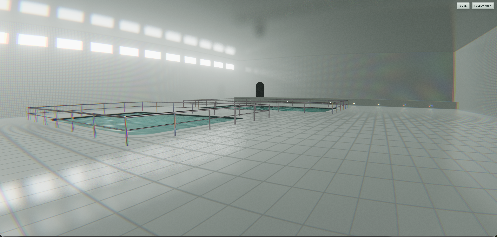

# Poolrooms

An eerie, liminal swimming pool environment built with **Three.js and WebGPU**.

Explore a surreal indoor pool space featuring procedural tiled surfaces, shimmering teal water, real-time reflections, atmospheric lighting, and a subtle fisheye lens effect. Designed to capture the unsettling calm of liminal spaces, the experience runs directly in your browser.



## Features

- **WebGPU Rendering** — Real-time 3D graphics powered by Three.js and TSL shaders.
- **Procedural Materials** — Shader-generated floor and wall tiles with anti-aliased grout lines and subtle surface variation.
- **Real-Time Reflections** — Custom planar reflections across the floor, pool water, walls, and ceiling.
- **Animated Water** — Layered directional waves, reflective highlights, and deep teal shading.
- **Atmospheric Lighting** — Soft illumination, glowing windows, environmental reflections, and distance fog.
- **Cinematic Post-Processing** — Bloom, fisheye distortion, subtle chromatic aberration, and film grain.
- **First-Person Exploration** — Explore the environment with desktop and mobile controls.
- **Responsive Controls** — Keyboard and mouse support on desktop, with dual-touch controls on mobile.
- **Immersive Atmosphere** — Muted colors, reflective surfaces, and liminal architecture designed to create an uncanny sense of space.

## Controls

### Desktop

| Input | Action |
| --- | --- |
| `W` `A` `S` `D` | Move |
| Arrow keys | Move |
| `Shift` | Sprint |
| Mouse | Look around |
| Click | Capture mouse pointer |
| `Esc` | Release mouse pointer |

### Mobile

- **Left thumb:** Move around.
- **Right thumb:** Look around.

## Built With

- [Three.js](https://threejs.org/)
- [WebGPU](https://developer.mozilla.org/en-US/docs/Web/API/WebGPU_API)
- [Three.js Shading Language (TSL)](https://threejs.org/docs/#api/en/tsl/TSL)
- JavaScript
- HTML and CSS

## Run Locally

### Requirements

- A modern web browser with compatible graphics support.
- Python or another local development server.
- The project's HDR environment map.

### Installation

1. Clone the repository using GitHub's **Code → Download ZIP** option, or download the project files.

2. Open a terminal in the project directory.

3. Start a local server:

   ```bash
   python -m http.server 8000
   ```

4. Open the project in your browser:

   ```text
   http://localhost:8000
   ```

Three.js modules are loaded through an HTML import map from a CDN, so no package installation or build step is required.


## Technical Highlights

### Procedural Tiling

Floor and wall tiles are generated directly in shaders using world-space coordinates. Anti-aliased grout lines and subtle color variation create detailed surfaces without requiring individual tile meshes.

### Custom Reflection System

Planar reflection render targets capture the environment from mirrored camera positions. The resulting images are projected back onto reflective surfaces, creating dynamic reflections that respond to the player's movement.

### Animated Water

Multiple directional wave functions generate continuously moving surface normals. Fresnel shading, procedural color variation, and sampled reflections give the water its characteristic dark teal appearance.

### Post-Processing

The final image combines bloom with a center-weighted fisheye distortion, subtle chromatic aberration, and animated film grain to reinforce the surreal, liminal atmosphere.

### Performance Considerations

Reflection rendering is one of the more demanding parts of the scene. Different reflection resolutions are used for different surfaces, and reflection passes are skipped for walls outside the camera's view.

## Browser Compatibility

The experience uses Three.js's WebGPU renderer and advanced shader features. A compatible browser and graphics device are required.

Use an up-to-date browser with WebGPU support for the best experience. Compatibility may vary depending on your browser, operating system, and GPU.

## Credits

Created by **Muhammad Bilal Khan**.

- [Follow on X](https://x.com/bk23544)

---

*Built with Three.js and WebGPU. Inspired by the unsettling beauty of liminal spaces.*